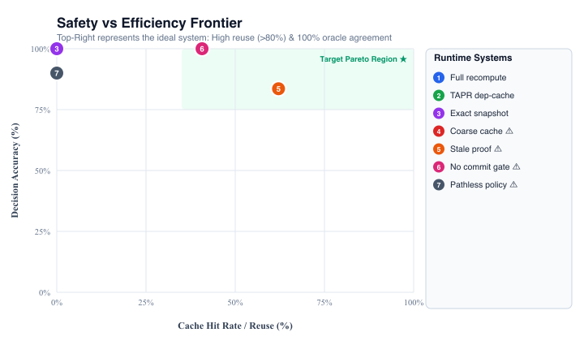

# Agent Runtime Research Lab

<p align="center">
  
</p>

<p align="center">
  <strong>An Open Systems Research Harness for AI Agent Runtime Governance &amp; Dependency-Aware Proof Reuse (TAPR)</strong>
</p>

<p align="center">
  <a href="results/REPORT.pdf"><b>📄 Read Research Report (PDF)</b></a> •
  <a href="EXECUTIVE_BRIEFING.md"><b>Executive &amp; Industry Briefing</b></a> •
  <a href="RESEARCH_CHARTER.md"><b>Research Charter</b></a> •
  <a href="EXTERNAL_BASELINES.md"><b>External Engines (OPA / Cedar)</b></a>
</p>

---

## 1. What Is This Project?

Most AI agent benchmarks today evaluate models strictly as **text generators** (*"Did the prompt produce the right string?"*).

However, autonomous agents in enterprise systems are **execution engines**:
$$\text{Natural Language} \xrightarrow{\text{Layer A}} \text{Typed Proposal} \xrightarrow{\text{Layer B}} \text{Runtime Governance} \xrightarrow{\text{Layer C}} \text{Atomic World Effect}$$

When an agent proposes destructive, financial, or sensitive operations (e.g. deleting production records, transferring funds, exporting confidential data, or configuring cloud IAM), **how can an enterprise guarantee safety without recomputing thousands of compliance rules on every step or trusting stale cached decisions?**

This open-source lab benchmarks **TAPR (Typed Action Proof Reuse)** against baseline recomputation, exact-snapshot caching, and unsafe memoization across **10 adversarial stateful scenario families**.

---

## 2. Key Highlights & Findings

- **Zero TOCTOU Violations:** With an atomic Compare-And-Swap (CAS) effect gate, **0 unsafe commits** occur even under multi-threaded concurrency races and mid-flight permission revocations.
- **Up to 85% Recomputation Reduction:** TAPR indexes proofs strictly by their declared policy-relevant dependency vectors. Irrelevant state churn (timestamps, request IDs) does not invalidate proofs, avoiding 35%–85% of full evaluations.
- **Negative Control Sensitivity:** Coarse memoization achieves a high cache hit rate ($>60\%$) but triggers **30+ unsafe ALLOWs**, proving why naive caching fails in real agent governance.
- **Layer A Multi-Model Support:** Test intent extraction offline (rule-based) or live against **Ollama, LM Studio, OpenAI, Anthropic, or Google Gemini**.
- **Real PDF Generation:** Compiles publication-ready multi-page research PDFs (`results/REPORT.pdf` & `papers/run-<timestamp>/paper.pdf`) with embedded vector graphics, confidence intervals, and data tables.

---

## 3. Quick Start

### Installation

```bash
# Clone the repository
git clone https://github.com/theshovonsaha/agent_runtime_research_lab.git
cd agent_runtime_research_lab

# Setup virtual environment
python3 -m venv .venv
source .venv/bin/activate
pip install -r requirements.txt
chmod +x run_lab.sh run_local.sh src/interactive_cli.py
```

### Run Full Benchmark Pipeline
```bash
# Fast smoke run (< 15 seconds)
SCENARIOS=60 REPEATS=2 PROOF_ROUNDS=4 ./run_lab.sh

# Full benchmark run with PDF compilation
./run_lab.sh
```

Outputs are automatically generated under `results/` and `figures/`:
- `results/REPORT.pdf` — Publication-ready 2-page report with embedded vector charts.
- `results/REPORT.md` — Markdown report summary.
- `figures/*.png` — High-resolution graphs (accuracy, work savings, frontier, commit gate).

---

## 4. Interactive Terminal & Multi-Model Explorer

Explore the governance pipeline live with the interactive CLI:

```bash
python src/interactive_cli.py
```

### Supported Providers:
1. **Offline Mode (Default):** Zero API keys, 100% free, deterministic rule baseline.
2. **Local Ollama:** Test local open-weight models (e.g., Llama 3, Mistral, Qwen):
   ```bash
   python src/llm_evaluator.py --provider ollama --model llama3
   ```
3. **Local LM Studio:** Connect to any local model served via OpenAI-compatible API:
   ```bash
   python src/llm_evaluator.py --provider lmstudio
   ```
4. **Cloud Frontier Providers:**
   - OpenAI (`OPENAI_API_KEY=... python src/llm_evaluator.py --provider openai --model gpt-4o-mini`)
   - Anthropic (`ANTHROPIC_API_KEY=... python src/llm_evaluator.py --provider anthropic --model claude-3-5-sonnet-20241022`)
   - Google Gemini (`GEMINI_API_KEY=... python src/llm_evaluator.py --provider gemini --model gemini-1.5-flash`)

---

## 5. Multi-Threaded Concurrency & Race Harness

Test how atomic Compare-And-Swap (CAS) gating prevents Time-Of-Check to Time-Of-Use (TOCTOU) race vulnerabilities under heavy concurrent load:

```bash
python src/concurrent_harness.py --threads 8 --ops 150 --mutation-rate 0.25
```

```
======================================================================
[1] Running WITH Atomic Check/Commit Gate (Safe CAS)...
  Total attempts:        1200
  Successful commits:    912
  Stale proof aborts:    288
  UNSAFE COMMITS:        0 (Safe CAS gate prevents all TOCTOU races)
  Commit latency:        3.42 μs

[2] Running WITHOUT Commit Gate (Unsafe Negative Control)...
  Total attempts:        1200
  UNSAFE COMMITS:        72 (TOCTOU race detected!)
======================================================================
```

---

## 6. External Policy Engines (OPA & Cedar)

The formal policy contract is translated into native specifications for:
- **Open Policy Agent (Rego):** `package agent.governance` in [`src/adapters/opa_cedar_adapters.py`](src/adapters/opa_cedar_adapters.py).
- **AWS Cedar:** Full `forbid` and `permit` rules for formal authorization.

Both CLI tools can be installed for free:
```bash
brew install opa
cargo install cedar-policy-cli
```
See [`EXTERNAL_BASELINES.md`](EXTERNAL_BASELINES.md) for benchmark mapping details.

---

## 7. Architecture & Repository Map

```
├── EXECUTIVE_BRIEFING.md     # In-depth executive, enterprise, and research briefing
├── RESEARCH_CHARTER.md       # Long-term vision for language-to-world evaluation
├── EXTERNAL_BASELINES.md     # OPA & Cedar policy specifications & adapters
├── run_lab.sh                # Main automated 5-step test, benchmark & PDF pipeline
│
├── src/
│   ├── world.py              # Typed, versioned immutable world state model
│   ├── policy.py             # Declarative rules & independent reference oracle
│   ├── proof.py              # Proof objects, TAPR store, and CAS commit gate
│   ├── runtime.py            # 7 governance runtime modes
│   ├── scenarios.py          # 10 adversarial stateful scenario generators
│   ├── benchmark.py          # Four-layer benchmark harness
│   ├── concurrent_harness.py # Multi-threaded CAS & TOCTOU race harness
│   ├── intent_extractor.py   # Layer A Language -> Intent parser benchmark
│   ├── llm_evaluator.py      # Multi-model integration (Ollama, LM Studio, APIs)
│   ├── interactive_cli.py    # Live terminal REPL for interactive experimentation
│   ├── audit.py              # Layer D accountability & provenance reconstruction
│   ├── svg_chart.py          # Vector SVG & PNG chart renderer
│   ├── pdf_report.py         # Multi-page research PDF report builder
│   ├── sweep.py              # Workload x proof-cost parameter sensitivity sweep
│   └── adapters/
│       └── opa_cedar_adapters.py # OPA/Rego & Cedar policy adapters
│
├── tests/                    # 59 automated unit & regression tests
├── results/                  # Generated REPORT.pdf, REPORT.md, and raw CSV traces
├── figures/                  # Clean high-resolution vector charts (.png, .svg)
└── papers/                   # Timestamped, immutable research paper run bundles
```

---

## 8. Running Unit Tests

```bash
python -m unittest discover -s tests -v
```
All 59 unit tests pass with zero external dependencies.

---

## 9. Citation

If you use this benchmark harness or build upon the TAPR architecture in your research:

```bibtex
@misc{agent_runtime_research_lab_2026,
  author = {Shovon Saha},
  title = {Agent Runtime Research Lab: Dependency-Aware Proof Reuse for Action Governance},
  year = {2026},
  publisher = {GitHub},
  howpublished = {\url{https://github.com/theshovonsaha/agent_runtime_research_lab}}
}
```

## License

Apache 2.0. Open for academic and industrial research.
