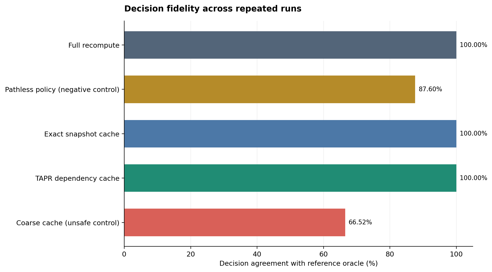
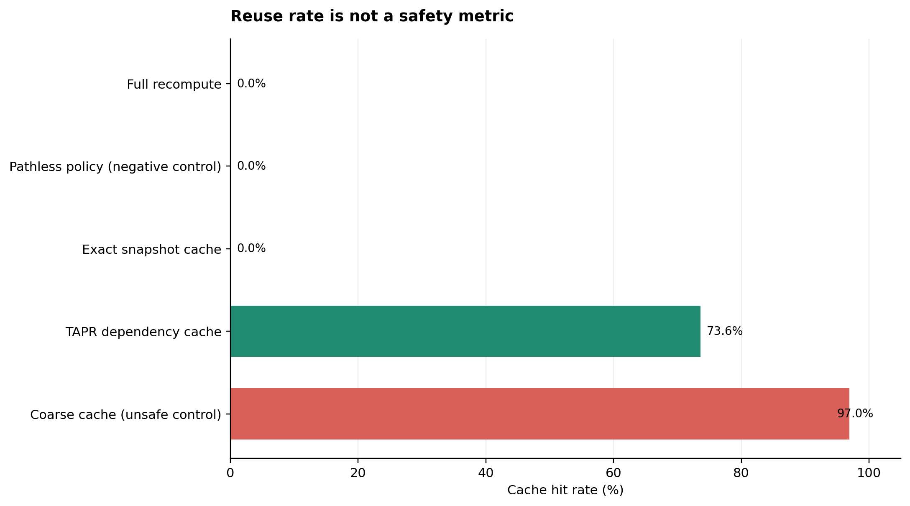
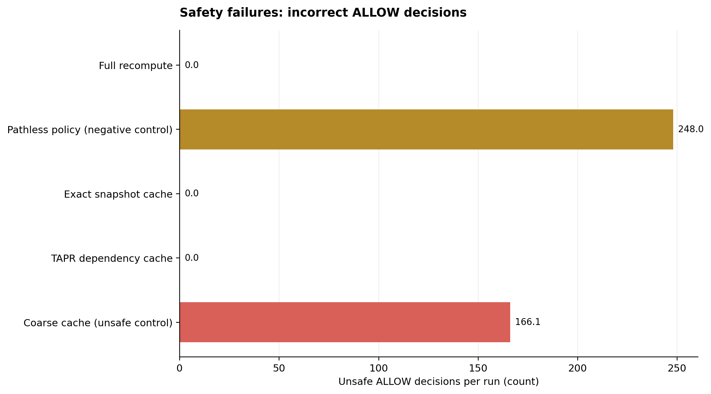
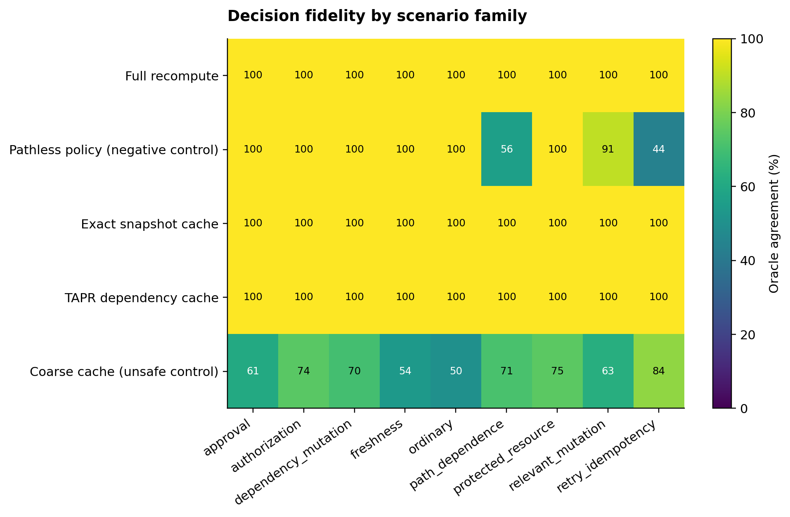
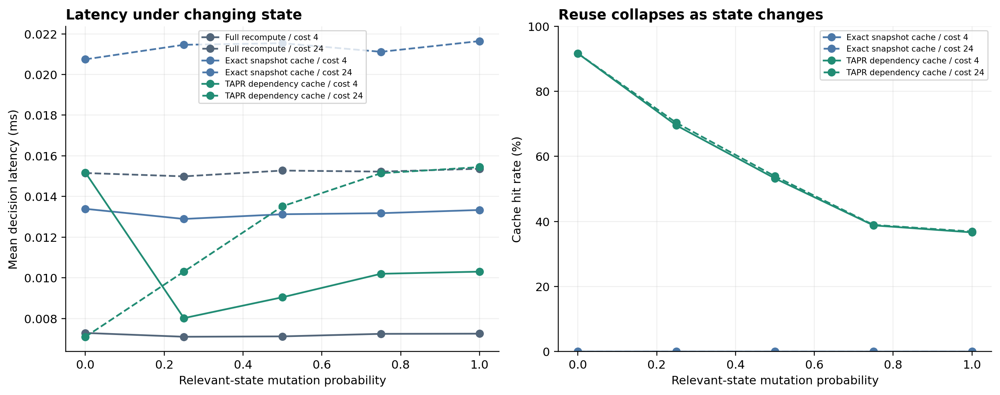

# Dependency-aware reuse for runtime action governance: a controlled synthetic benchmark

**Manuscript status:** automatically generated experimental draft; not submission-certified.  
**Lab version:** 0.2.0 · **Run ID:** run-20261012T002329Z · **UTC:** 2026-10-12T00:23:29.389663+00:00  
**Study type:** offline synthetic systems experiment.

## Abstract

Runtime governance systems evaluate whether a proposed action is admissible under policy and execution state. Repeated evaluation may be costly, while reuse of prior decisions can be unsound when relevant state changes. This study compares full recomputation, exact-snapshot caching, dependency-aware caching, and intentionally flawed negative controls on a deterministic synthetic workload. The benchmark records decision agreement with a reference oracle, unsafe allows, false denials, cache-hit rate, full evaluations, and local latency. In this run, dependency-aware caching matched the oracle on 2000 decisions and reduced full evaluations by 73.6% relative to full recomputation. These findings are limited to the implemented policy contract and synthetic workload; they do not establish safety for arbitrary policies, superiority over external policy engines, or novelty relative to prior work.

## 1. Introduction

Caching authorization or admissibility decisions creates a state-validity problem: a prior result can be reused only while the conditions supporting it remain valid. This experiment evaluates a dependency-aware cache against recomputation and snapshot-based reuse under controlled state mutation. The contribution evaluated here is an implementation-level comparison, not a claim that dependency-aware caching or runtime governance is itself new.

## 2. Experimental methods

### 2.1 Workload and systems

The benchmark uses a deterministic synthetic workload generated from a fixed seed. The compared systems are full recomputation, exact-snapshot caching, dependency-aware caching, a coarse cache negative control, and a pathless-policy negative control. Negative controls are designed to expose metric blind spots and are not intended as fair performance competitors.

### 2.2 Measures

Decision agreement is the proportion of decisions matching the reference oracle. Unsafe ALLOW counts incorrect allows; false DENY counts incorrect denials. Cache-hit rate and full-evaluation count measure reuse behavior. Latency is measured locally using Python's high-resolution performance counter. These timings are environment-specific and should not be compared directly across machines.

### 2.3 Reproducibility

The run manifest records configuration, runtime, and SHA-256 hashes of input result files. Raw summary metrics, decision traces when available, generated cases, and figures are included in this run bundle. The benchmark is offline and synthetic; it does not invoke an LLM or execute external actions.

## 3. Results

| System | Oracle agreement | Unsafe ALLOW | False DENY | Cache hit | Full evaluations | Mean latency (ms) |
|---|---:|---:|---:|---:|---:|---:|
| Full recomputation | 100.00% | 0 | 0 | 0.0% | 2000 | 0.015803 |
| Pathless-policy negative control | 87.60% | 248 | 0 | 0.0% | 2000 | 0.016065 |
| Exact snapshot cache | 100.00% | 0 | 0 | 0.0% | 2000 | 0.022226 |
| TAPR dependency cache | 100.00% | 0 | 0 | 73.6% | 528 | 0.010267 |
| Coarse cache negative control | 61.25% | 279 | 233 | 97.0% | 61 | 0.000949 |

Dependency-aware caching performed 73.6% fewer full evaluations than full recomputation in this run. Cache-hit rate is not a safety metric: the coarse negative control must be assessed using its decision errors as well as its reuse rate.

## 4. Limitations

The policy evaluator and oracle are separately implemented but derive from the same human-authored policy contract. Workloads are synthetic and typed; no natural-language intent extraction or LLM behavior is tested. The proof-work mechanism is a controlled CPU-cost proxy rather than a real proof checker. Dependency completeness is only evaluated against declared mutation fields. No real OPA/Rego or Cedar comparison, distributed cache, atomic production transaction, or genuine concurrent race test is included. Timing estimates are local microbenchmarks. These limitations prevent broad claims about real-world safety, generalization, or publication-level novelty.

## 5. Conclusion

The current experiment provides a reproducible test harness for studying decision reuse under a declared synthetic policy contract. The observed reduction in full evaluations motivates further tests with independently authored policies, real policy engines, and concurrency-aware commit semantics. No claim of general safety or external superiority follows from this experiment alone.

## Data and artifact availability

This run directory contains a manifest, hashes, raw data, and figures. Before submission, archive the source and run bundle in a permanent repository, specify a license, pin dependencies, and have an independent party reproduce the principal tables and figures.

## References

1. Open Policy Agent. *Policy Performance*. https://www.openpolicyagent.org/docs/policy-performance
2. Cedar Policy. *Cedar documentation*. https://docs.cedarpolicy.com/
3. ACM SIGSIM PADS. *Reproducibility and Artifact Evaluation*. https://sigsim.acm.org/conf/pads/2024/blog/artifact-evaluation/
