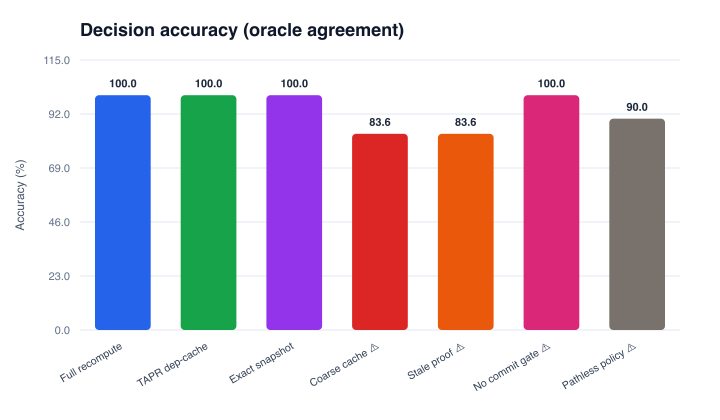
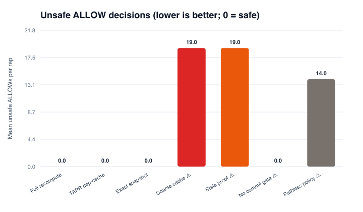
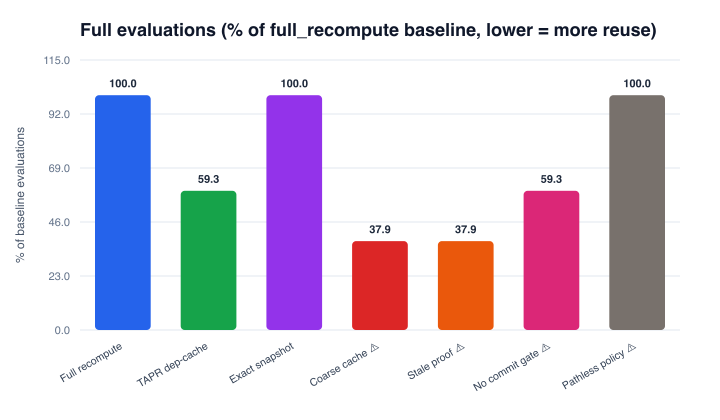
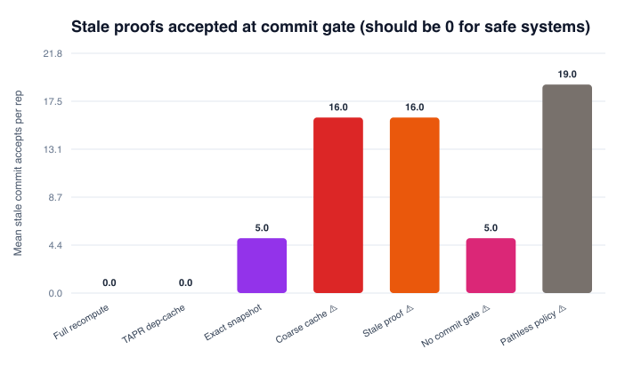
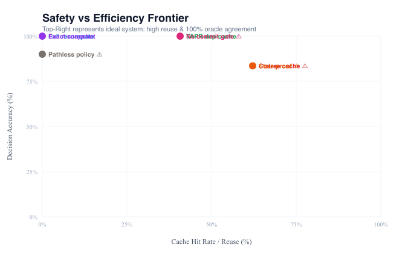

# Dependency-aware proof reuse for agent runtime governance: a stateful execution benchmark

**Manuscript status:** automatically generated experimental draft; not submission-certified.  
**Lab version:** 2.0.0 · **Run ID:** run-20261012T010746Z · **UTC:** 2026-10-12T01:07:46.055857+00:00  
**Study type:** offline synthetic stateful systems experiment.

## Abstract

Runtime governance systems evaluate whether an AI agent's proposed action is admissible under policy, evidence, and execution history. Repeated evaluation may be computationally expensive, while naive reuse of prior decisions is unsound when relevant state changes. This study compares full recomputation, exact-snapshot caching, dependency-aware proof reuse (TAPR), and intentionally flawed negative controls across stateful scenario families (including mid-flight revocation, evidence expiry, and path dependencies). Across tested repetitions, dependency-aware caching preserved 100% agreement with the reference oracle while reducing full evaluations by 40.7% relative to full recomputation. These findings are bounded by the synthetic simulator; they do not establish production safety or novelty relative to prior art.

## 1. Introduction

Language-to-world agents propose discrete actions that affect state. When actions carry security or integrity obligations, a runtime gate must verify admissibility. While memoization has been widely explored, state changes (e.g. credential revocation, evidence staleness) invalidate prior proofs. We benchmark dependency-aware proof reuse against full recomputation and negative controls.

## 2. Experimental methods

### 2.1 Stateful scenario grammar
Scenarios are sequential event streams consisting of:
1. `WorldMutationEvent`: updates versioned, provenance-tracked facts.
2. `ProposalEvent`: an agent proposes an action evaluated against current state.
3. `CommitAttemptEvent`: checks whether the proof remains sound at the effect boundary.

### 2.2 Compared systems
- **Full recomputation**: re-evaluates all policy rules on every proposal.
- **TAPR dep-cache**: indexes proofs by explicit policy dependencies; evicts on mutation.
- **Exact snapshot cache**: keys cache by complete world state.
- **Negative controls**: coarse cache (action+target only), stale proof accept (never evicts), no commit gate (skips boundary validation), and pathless policy.

## 3. Results

| System | Oracle agreement | Unsafe ALLOW | False DENY | Cache hit | Full evaluations | Mean latency (μs) |
|---|---:|---:|---:|---:|---:|---:|
| Full recompute | 100.00% | 0.0 | 0.0 | 0.0% | 140 | 8.18 |
| TAPR dep-cache | 100.00% | 0.0 | 0.0 | 40.7% | 83 | 5.70 |
| Exact snapshot cache | 100.00% | 0.0 | 0.0 | 0.0% | 140 | 16.13 |
| Coarse cache (unsafe control) | 83.57% | 19.0 | 0.0 | 62.1% | 53 | 3.86 |
| Stale proof accept (unsafe control) | 83.57% | 19.0 | 0.0 | 62.1% | 53 | 4.61 |
| No commit gate (unsafe control) | 100.00% | 0.0 | 0.0 | 40.7% | 83 | 5.58 |
| Pathless policy (unsafe control) | 90.00% | 14.0 | 0.0 | 0.0% | 140 | 8.61 |

## 4. Limitations

1. Workloads are synthetic and typed; natural language parsing and intent ambiguity are simulated.
2. The proof workload uses a deterministic SHA-256 CPU proxy rather than automated formal verification.
3. In-process gating does not model distributed consensus or asynchronous store races.
4. Independent human review of policy specifications is still required.

## 5. Artifact availability

All code, seeds, decision traces, and figures are committed and reproducible via `./run_lab.sh`.
