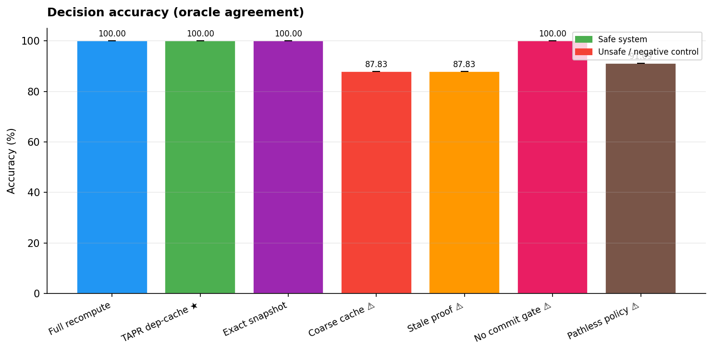
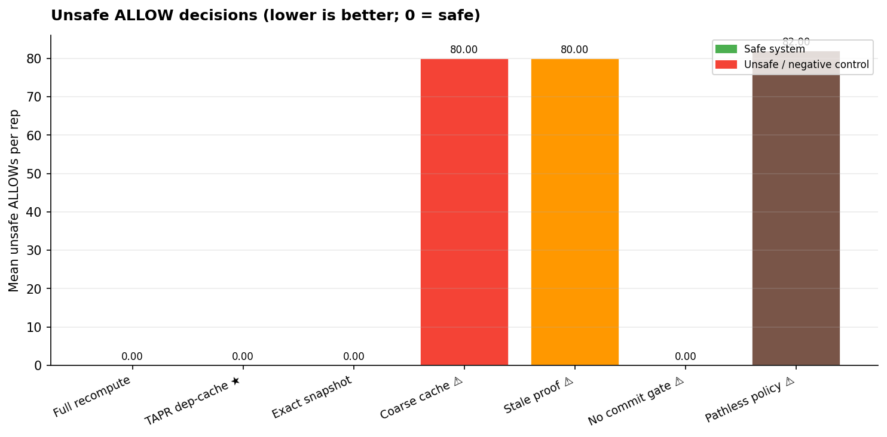
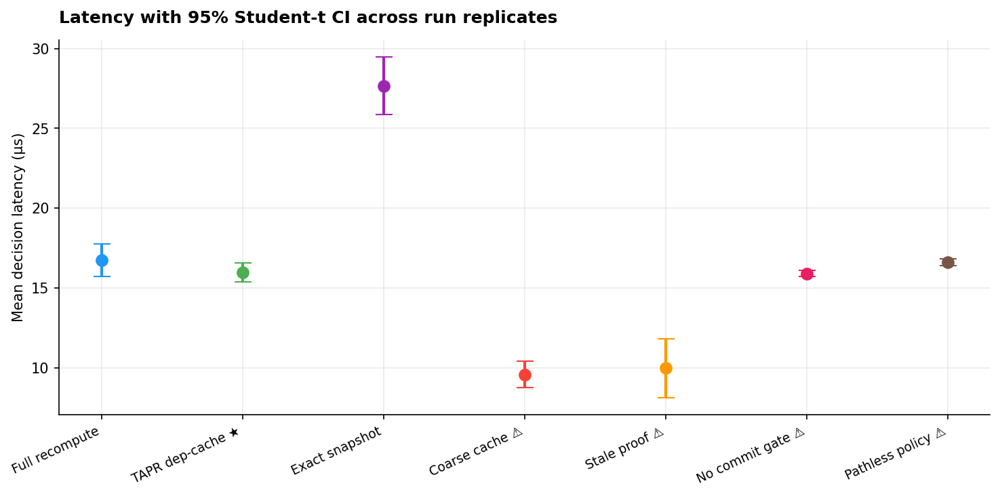
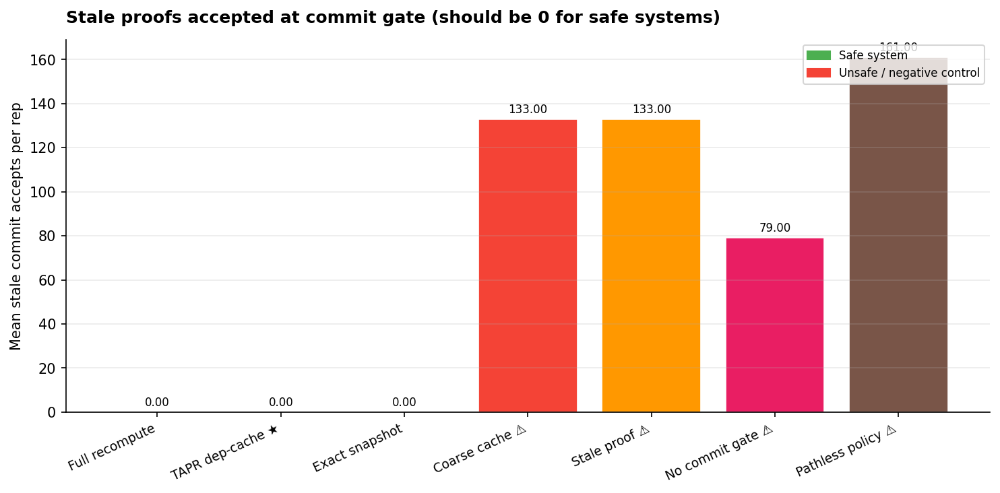
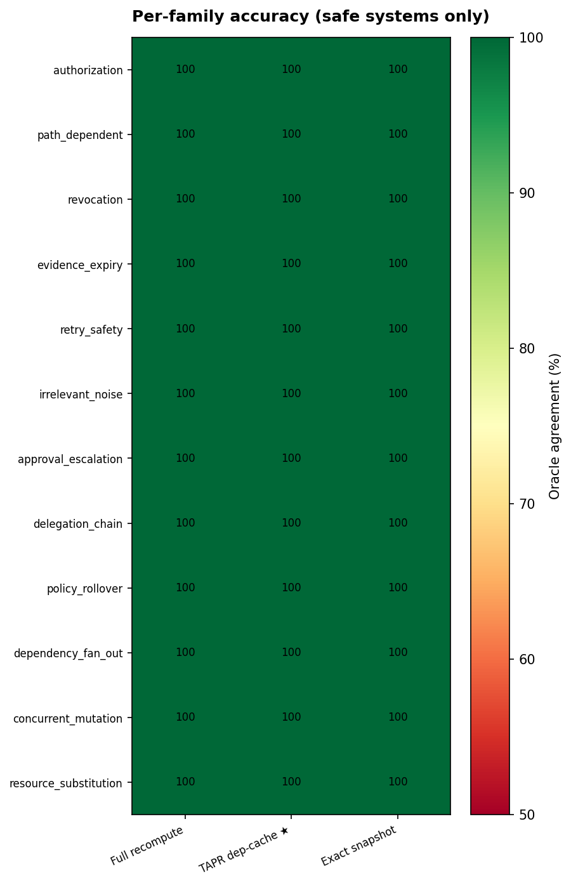
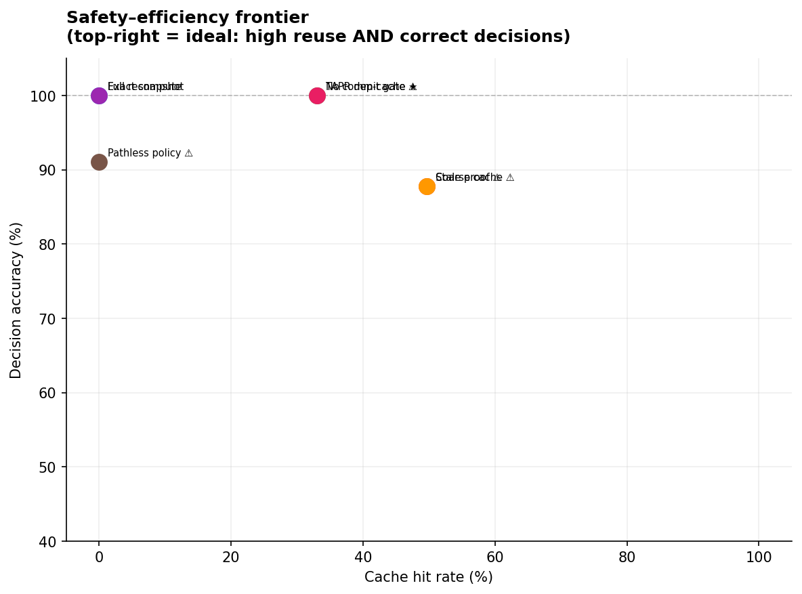

# Dependency-aware proof reuse for agent runtime governance: a stateful execution benchmark

**Manuscript status:** automatically generated experimental draft; not submission-certified.  
**Lab version:** 2.0.0 · **Run ID:** run-20261012T034015367049Z · **UTC:** 2026-10-12T03:40:15.388757+00:00  
**Study type:** offline synthetic stateful systems experiment.

## Abstract

**Research question.** Under identical typed event histories and policy semantics, can dependency-aware proof reuse preserve proposal decisions and commit authorization while reducing computational work relative to full recomputation? The study compares full recomputation, TAPR dependency caching, exact-snapshot caching, and intentionally faulty negative controls. Results below are measured only for this run and synthetic simulator. They do not establish production safety, general superiority, or novelty.

## 1. Falsifiable hypotheses

- **H1, proposal equivalence:** TAPR proposal verdicts match the independent state-only evaluator for all generated cases.
- **H2, commit safety:** a proof established before a relevant state change cannot authorize a later effect; the check/effect transaction serializes with state mutation.
- **H3, selective efficiency:** proof reuse reduces work in reusable-dependency regimes, but validation costs or low reuse can make TAPR slower than recomputation.

## 2. Methods

### 2.1 Runtime variants and operational definitions

- **Full recompute:** evaluate current typed policy conditions for every proposal; recompute at commit.
- **TAPR dependency cache:** reuse a proof only when its declared facts, policy version, and in-process policy identity still match; revalidate/recompute at commit.
- **Exact snapshot cache:** use a hash of the complete world snapshot and action identity.
- **Negative controls:** coarse action/target cache, stale-proof acceptance, no commit gate, and pathless policy. These are intentionally unsafe comparators, not candidate implementations.
- The authoritative implementation is `src/tapr/`; legacy `src/*.py` import-compatible modules re-export it. Both import paths are covered by tests.

### 2.2 Dependency contract

The ordered policy evaluator accumulates facts actually inspected by each
nonmatching rule and the matching rule. A cached verdict therefore pins the
matched rule's inputs plus inputs read while establishing that earlier rules
did not fire. The rule functions supply those reads; `required_fact_keys`
replays that evaluator contract rather than maintaining a second handwritten
precedence table. Irrelevant metadata is intentionally excluded when it is not
read by any applicable rule. This contract is authored in the same project as
the evaluator and requires external policy-specification review.

### 2.3 Independent oracle and its limits

`tapr.oracle.evaluate` computes expected proposal verdict and commit authorization directly from current `WorldState` facts. It imports the state model only; it does not call the policy evaluator, dependency validator, proof cache, or commit gate. A structural regression test checks those imports and a runtime test replaces `Policy.evaluate` with a failing stub while the oracle continues to evaluate. Independence is implementation-level, not specification-level: both evaluator and oracle encode a human-authored contract in this repository, so shared misunderstanding remains possible.

### 2.4 Scenario and mutation procedure

Stateful scenarios are event streams of proposals, commits, policy rollovers, and versioned world mutations. Probe B changes authorization, scope, approvals, evidence revisions, protected/held resources, sensitive-read/retry/delegation history, policy version, irrelevant metadata, and resource identity. Omitted dependencies are fault-injected. Probe C uses recorded seeds across nine workload profiles, two scenario sizes (24, 64), two repetitions, and all seven registered runtime variants. Profiles vary reuse/noise, dependency fan-out, path behavior, policy rollovers, concurrent-mutation scenarios, and resource substitution. Complete serialized inputs and per-decision records are included in `data/`.

### 2.5 Atomic effect model

`AtomicWorldStore` holds a single-process mutex from reading current state through gate validation and recording a simulated effect. A deterministic barrier test pauses after authorization and attempts revocation before effect recording; the mutation must block until the effect is serialized. Competing compare-and-swap updates are tested with the same version and exactly one may succeed. These results demonstrate only in-process simulation behavior, not database transactionality, distributed consensus, crash recovery, or external side-effect atomicity. Repeated proof use is permitted while dependencies remain valid; a failed effect is recorded as a failed attempt and is not counted as an occurred effect.

### 2.6 Environment, configuration, and reproducibility

- Source revision: `1c4fa839036b5dfe16d610ab930c7dc08a6748d0`; worktree dirty: `True`.
- Runtime: `3.14.6 (main, Jun 10 2026, 10:03:53) [Clang 21.0.0 (clang-2100.0.123.102)]`; platform: `macOS-27.0-arm64-arm-64bit-Mach-O`.
- Dependencies: `{"matplotlib": "3.10.8", "numpy": "2.5.4", "pytest": "9.1.1"}`.
- Benchmark configuration: `{"proof_rounds": 16, "repeats": 5, "scenarios": 400, "seed": 20261011, "systems": ["full_recompute", "tapr_dep_cache", "exact_snapshot_cache", "coarse_cache", "stale_proof_accept", "no_commit_gate", "pathless_policy"]}`.
- Probe seed/configuration: `{"candidate_counterexample_count": 0, "counterexample_count": 1110, "expected_negative_control_counterexample_count": 1110, "probe_a": {"commit_mutation_race_effect_count": 1, "competing_cas_successes": 1, "failed_effect_count": 0, "mutation_blocked_during_authorized_effect": true, "reusable_effect_count": 2, "safe_stale_effect_occurred": false, "unsafe_control_effect_occurred": true}, "probe_b_cases": 85, "probe_b_disagreements_by_system": {"coarse_cache": 9, "exact_snapshot_cache": 0, "full_recompute": 0, "no_commit_gate": 9, "pathless_policy": 9, "stale_proof_accept": 9, "tapr_dep_cache": 0}, "probe_b_oracle_disagreements": 36, "probe_c_configurations": 252, "probe_c_decision_records": 21882, "probe_c_disagreements_by_system": {"coarse_cache": 311, "exact_snapshot_cache": 0, "full_recompute": 0, "no_commit_gate": 138, "pathless_policy": 314, "stale_proof_accept": 311, "tapr_dep_cache": 0}, "runtime_variants": ["full_recompute", "tapr_dep_cache", "exact_snapshot_cache", "coarse_cache", "stale_proof_accept", "no_commit_gate", "pathless_policy"], "seed": 20261011}`.

Reproduce with `PYTHON=.venv/bin/python ./reproduce_research.sh <seed> 400 5 16 1`. The positional arguments are seed, scenario count, repetitions, proof-work rounds, and whether to run the quick sensitivity sweep. The script runs both `unittest` and `pytest`, then the benchmark, deterministic parameter sweep, three probes, figures, README metric refresh, and paper bundle. It creates a new timestamped result directory. The proof-work measure is a deterministic SHA-256 CPU-work proxy, not formal verification. Per-run manifests contain command lines, source revision, dirty-worktree status, dependency versions, configuration, and checksums.

## 3. Results

### 3.1 Benchmark summary

Proposal accuracy and commit-boundary accuracy are reported separately. `Effects` counts simulated in-memory effects actually recorded after runtime approval; `Unsafe effects` counts effects where the independent oracle says commit authorization was false. They are not measurements of a real external adapter.

| System | Proposal accuracy (95% t CI) | Commit accuracy (95% t CI) | Unsafe ALLOW | Commit false denies | Stale accepts | Effects | Unsafe effects | Cache hit | Full evals | Total work | Proposal mean μs | Commit p95 μs |
|---|---:|---:|---:|---:|---:|---:|---:|---:|---:|---:|---:|---:|
| Full recompute | 100.00% [100.00, 100.00] | 100.00% [100.00, 100.00] | 0.0 | 0.0 | 0.0 | 83.0 | 0.0 | 0.0% | 920 | 19536.0 | 16.76 | 21.90 |
| TAPR dep-cache | 100.00% [100.00, 100.00] | 100.00% [100.00, 100.00] | 0.0 | 0.0 | 0.0 | 83.0 | 0.0 | 33.0% | 616 | 11312.0 | 15.99 | 34.74 |
| Exact snapshot cache | 100.00% [100.00, 100.00] | 100.00% [100.00, 100.00] | 0.0 | 0.0 | 0.0 | 83.0 | 0.0 | 0.0% | 920 | 16240.0 | 27.67 | 28.67 |
| Coarse cache (unsafe control) | 87.83% [87.83, 87.83] | 45.18% [45.18, 45.18] | 80.0 | 32.0 | 133.0 | 184.0 | 133.0 | 49.7% | 463 | 7408.0 | 9.59 | 0.18 |
| Stale proof accept (unsafe control) | 87.83% [87.83, 87.83] | 45.18% [45.18, 45.18] | 80.0 | 32.0 | 133.0 | 184.0 | 133.0 | 49.7% | 463 | 7408.0 | 9.99 | 0.24 |
| No commit gate (unsafe control) | 100.00% [100.00, 100.00] | 73.75% [73.75, 73.75] | 0.0 | 0.0 | 79.0 | 162.0 | 79.0 | 33.0% | 616 | 9856.0 | 15.92 | 0.71 |
| Pathless policy (unsafe control) | 91.09% [91.09, 91.09] | 46.51% [46.51, 46.51] | 82.0 | 0.0 | 161.0 | 244.0 | 161.0 | 0.0% | 920 | 14720.0 | 16.62 | 0.18 |

The TAPR full-evaluation reduction relative to recomputation is 33.04% in this run, computed as `1 - mean(TAPR full_evaluations) / mean(full_recompute full_evaluations)`. This work-count proxy excludes the engineering cost of discovering and maintaining dependency declarations; latency is reported separately.

### 3.2 Workload-profile and break-even outcomes

Each profile row aggregates the per-seed/per-repetition observations in the raw CSV. A profile counts as a latency break-even only when mean TAPR proposal latency is lower than mean full-recompute latency in this measured environment. Profiles below are not pooled into a universal estimate.

| Workload profile | Full accuracy | TAPR accuracy | Full commit accuracy | TAPR commit accuracy | Full/TAPR cache hit | Full/TAPR total work | Full/TAPR mean proposal μs |
|---|---:|---:|---:|---:|---:|---:|---:|
| low_reuse | 100.0% | 100.0% | 100.0% | 100.0% | 0.0%/0.0% | 2816.0/1720.0 | 14.62/16.92 |
| high_reuse | 100.0% | 100.0% | 100.0% | 100.0% | 0.0%/83.4% | 8624.0/1408.0 | 13.49/8.60 |
| dependency_fanout | 100.0% | 100.0% | 100.0% | 100.0% | 0.0%/11.2% | 2816.0/2288.0 | 13.95/18.80 |
| path_chain | 100.0% | 100.0% | 100.0% | 100.0% | 0.0%/0.0% | 4728.0/2816.0 | 13.91/16.43 |
| policy_low | 100.0% | 100.0% | 100.0% | 100.0% | 0.0%/0.0% | 2816.0/1512.0 | 14.29/16.87 |
| policy_high | 100.0% | 100.0% | 100.0% | 100.0% | 0.0%/0.0% | 2816.0/2688.0 | 14.27/16.58 |
| mutation_low | 100.0% | 100.0% | 100.0% | 100.0% | 0.0%/0.0% | 2816.0/1568.0 | 14.71/16.59 |
| mutation_high | 100.0% | 100.0% | 100.0% | 100.0% | 0.0%/0.0% | 2816.0/2512.0 | 14.20/17.00 |
| resource_substitution | 100.0% | 100.0% | 100.0% | 100.0% | 0.0%/0.0% | 4096.0/2688.0 | 15.99/18.30 |

Break-even by this criterion was observed in 1 of 9 profiles: high_reuse. This is descriptive and machine-specific. The exact per-seed observations are tabulated in the raw data and summarized here:

| Seed | Profile | Size | Replicate | Full proposal acc. | TAPR proposal acc. | Full commit acc. | TAPR commit acc. | Full/TAPR cache hit |
|---:|---|---:|---:|---:|---:|---:|---:|---:|
| 20263435 | low_reuse | 24 | 0 | 100.0% | 100.0% | 100.0% | 100.0% | 0.0%/0.0% |
| 20263436 | low_reuse | 24 | 1 | 100.0% | 100.0% | 100.0% | 100.0% | 0.0%/0.0% |
| 20267475 | low_reuse | 64 | 0 | 100.0% | 100.0% | 100.0% | 100.0% | 0.0%/0.0% |
| 20267476 | low_reuse | 64 | 1 | 100.0% | 100.0% | 100.0% | 100.0% | 0.0%/0.0% |
| 20363438 | high_reuse | 24 | 0 | 100.0% | 100.0% | 100.0% | 100.0% | 0.0%/84.4% |
| 20363439 | high_reuse | 24 | 1 | 100.0% | 100.0% | 100.0% | 100.0% | 0.0%/82.4% |
| 20367478 | high_reuse | 64 | 0 | 100.0% | 100.0% | 100.0% | 100.0% | 0.0%/83.3% |
| 20367479 | high_reuse | 64 | 1 | 100.0% | 100.0% | 100.0% | 100.0% | 0.0%/83.6% |
| 20463441 | dependency_fanout | 24 | 0 | 100.0% | 100.0% | 100.0% | 100.0% | 0.0%/8.7% |
| 20463442 | dependency_fanout | 24 | 1 | 100.0% | 100.0% | 100.0% | 100.0% | 0.0%/19.6% |
| 20467481 | dependency_fanout | 64 | 0 | 100.0% | 100.0% | 100.0% | 100.0% | 0.0%/12.1% |
| 20467482 | dependency_fanout | 64 | 1 | 100.0% | 100.0% | 100.0% | 100.0% | 0.0%/7.9% |
| 20563444 | path_chain | 24 | 0 | 100.0% | 100.0% | 100.0% | 100.0% | 0.0%/0.0% |
| 20563445 | path_chain | 24 | 1 | 100.0% | 100.0% | 100.0% | 100.0% | 0.0%/0.0% |
| 20567484 | path_chain | 64 | 0 | 100.0% | 100.0% | 100.0% | 100.0% | 0.0%/0.0% |
| 20567485 | path_chain | 64 | 1 | 100.0% | 100.0% | 100.0% | 100.0% | 0.0%/0.0% |
| 20663447 | policy_low | 24 | 0 | 100.0% | 100.0% | 100.0% | 100.0% | 0.0%/0.0% |
| 20663448 | policy_low | 24 | 1 | 100.0% | 100.0% | 100.0% | 100.0% | 0.0%/0.0% |
| 20667487 | policy_low | 64 | 0 | 100.0% | 100.0% | 100.0% | 100.0% | 0.0%/0.0% |
| 20667488 | policy_low | 64 | 1 | 100.0% | 100.0% | 100.0% | 100.0% | 0.0%/0.0% |
| 20763450 | policy_high | 24 | 0 | 100.0% | 100.0% | 100.0% | 100.0% | 0.0%/0.0% |
| 20763451 | policy_high | 24 | 1 | 100.0% | 100.0% | 100.0% | 100.0% | 0.0%/0.0% |
| 20767490 | policy_high | 64 | 0 | 100.0% | 100.0% | 100.0% | 100.0% | 0.0%/0.0% |
| 20767491 | policy_high | 64 | 1 | 100.0% | 100.0% | 100.0% | 100.0% | 0.0%/0.0% |
| 20863453 | mutation_low | 24 | 0 | 100.0% | 100.0% | 100.0% | 100.0% | 0.0%/0.0% |
| 20863454 | mutation_low | 24 | 1 | 100.0% | 100.0% | 100.0% | 100.0% | 0.0%/0.0% |
| 20867493 | mutation_low | 64 | 0 | 100.0% | 100.0% | 100.0% | 100.0% | 0.0%/0.0% |
| 20867494 | mutation_low | 64 | 1 | 100.0% | 100.0% | 100.0% | 100.0% | 0.0%/0.0% |
| 20963456 | mutation_high | 24 | 0 | 100.0% | 100.0% | 100.0% | 100.0% | 0.0%/0.0% |
| 20963457 | mutation_high | 24 | 1 | 100.0% | 100.0% | 100.0% | 100.0% | 0.0%/0.0% |
| 20967496 | mutation_high | 64 | 0 | 100.0% | 100.0% | 100.0% | 100.0% | 0.0%/0.0% |
| 20967497 | mutation_high | 64 | 1 | 100.0% | 100.0% | 100.0% | 100.0% | 0.0%/0.0% |
| 21063459 | resource_substitution | 24 | 0 | 100.0% | 100.0% | 100.0% | 100.0% | 0.0%/0.0% |
| 21063460 | resource_substitution | 24 | 1 | 100.0% | 100.0% | 100.0% | 100.0% | 0.0%/0.0% |
| 21067499 | resource_substitution | 64 | 0 | 100.0% | 100.0% | 100.0% | 100.0% | 0.0%/0.0% |
| 21067500 | resource_substitution | 64 | 1 | 100.0% | 100.0% | 100.0% | 100.0% | 0.0%/0.0% |

### 3.3 Scenario-family results

| Scenario family | System | Proposal accuracy |
|---|---|---:|
| authorization | Full recompute | 100.0% |
| path_dependent | Full recompute | 100.0% |
| revocation | Full recompute | 100.0% |
| evidence_expiry | Full recompute | 100.0% |
| retry_safety | Full recompute | 100.0% |
| irrelevant_noise | Full recompute | 100.0% |
| approval_escalation | Full recompute | 100.0% |
| delegation_chain | Full recompute | 100.0% |
| policy_rollover | Full recompute | 100.0% |
| dependency_fan_out | Full recompute | 100.0% |
| concurrent_mutation | Full recompute | 100.0% |
| resource_substitution | Full recompute | 100.0% |
| authorization | TAPR dep-cache | 100.0% |
| path_dependent | TAPR dep-cache | 100.0% |
| revocation | TAPR dep-cache | 100.0% |
| evidence_expiry | TAPR dep-cache | 100.0% |
| retry_safety | TAPR dep-cache | 100.0% |
| irrelevant_noise | TAPR dep-cache | 100.0% |
| approval_escalation | TAPR dep-cache | 100.0% |
| delegation_chain | TAPR dep-cache | 100.0% |
| policy_rollover | TAPR dep-cache | 100.0% |
| dependency_fan_out | TAPR dep-cache | 100.0% |
| concurrent_mutation | TAPR dep-cache | 100.0% |
| resource_substitution | TAPR dep-cache | 100.0% |
| authorization | Exact snapshot cache | 100.0% |
| path_dependent | Exact snapshot cache | 100.0% |
| revocation | Exact snapshot cache | 100.0% |
| evidence_expiry | Exact snapshot cache | 100.0% |
| retry_safety | Exact snapshot cache | 100.0% |
| irrelevant_noise | Exact snapshot cache | 100.0% |
| approval_escalation | Exact snapshot cache | 100.0% |
| delegation_chain | Exact snapshot cache | 100.0% |
| policy_rollover | Exact snapshot cache | 100.0% |
| dependency_fan_out | Exact snapshot cache | 100.0% |
| concurrent_mutation | Exact snapshot cache | 100.0% |
| resource_substitution | Exact snapshot cache | 100.0% |
| authorization | Coarse cache (unsafe control) | 100.0% |
| path_dependent | Coarse cache (unsafe control) | 100.0% |
| revocation | Coarse cache (unsafe control) | 100.0% |
| evidence_expiry | Coarse cache (unsafe control) | 100.0% |
| retry_safety | Coarse cache (unsafe control) | 50.0% |
| irrelevant_noise | Coarse cache (unsafe control) | 100.0% |
| approval_escalation | Coarse cache (unsafe control) | 50.0% |
| delegation_chain | Coarse cache (unsafe control) | 50.0% |
| policy_rollover | Coarse cache (unsafe control) | 100.0% |
| dependency_fan_out | Coarse cache (unsafe control) | 64.9% |
| concurrent_mutation | Coarse cache (unsafe control) | 100.0% |
| resource_substitution | Coarse cache (unsafe control) | 100.0% |
| authorization | Stale proof accept (unsafe control) | 100.0% |
| path_dependent | Stale proof accept (unsafe control) | 100.0% |
| revocation | Stale proof accept (unsafe control) | 100.0% |
| evidence_expiry | Stale proof accept (unsafe control) | 100.0% |
| retry_safety | Stale proof accept (unsafe control) | 50.0% |
| irrelevant_noise | Stale proof accept (unsafe control) | 100.0% |
| approval_escalation | Stale proof accept (unsafe control) | 50.0% |
| delegation_chain | Stale proof accept (unsafe control) | 50.0% |
| policy_rollover | Stale proof accept (unsafe control) | 100.0% |
| dependency_fan_out | Stale proof accept (unsafe control) | 64.9% |
| concurrent_mutation | Stale proof accept (unsafe control) | 100.0% |
| resource_substitution | Stale proof accept (unsafe control) | 100.0% |
| authorization | No commit gate (unsafe control) | 100.0% |
| path_dependent | No commit gate (unsafe control) | 100.0% |
| revocation | No commit gate (unsafe control) | 100.0% |
| evidence_expiry | No commit gate (unsafe control) | 100.0% |
| retry_safety | No commit gate (unsafe control) | 100.0% |
| irrelevant_noise | No commit gate (unsafe control) | 100.0% |
| approval_escalation | No commit gate (unsafe control) | 100.0% |
| delegation_chain | No commit gate (unsafe control) | 100.0% |
| policy_rollover | No commit gate (unsafe control) | 100.0% |
| dependency_fan_out | No commit gate (unsafe control) | 100.0% |
| concurrent_mutation | No commit gate (unsafe control) | 100.0% |
| resource_substitution | No commit gate (unsafe control) | 100.0% |
| authorization | Pathless policy (unsafe control) | 100.0% |
| path_dependent | Pathless policy (unsafe control) | 50.0% |
| revocation | Pathless policy (unsafe control) | 100.0% |
| evidence_expiry | Pathless policy (unsafe control) | 100.0% |
| retry_safety | Pathless policy (unsafe control) | 50.0% |
| irrelevant_noise | Pathless policy (unsafe control) | 100.0% |
| approval_escalation | Pathless policy (unsafe control) | 100.0% |
| delegation_chain | Pathless policy (unsafe control) | 50.0% |
| policy_rollover | Pathless policy (unsafe control) | 100.0% |
| dependency_fan_out | Pathless policy (unsafe control) | 100.0% |
| concurrent_mutation | Pathless policy (unsafe control) | 100.0% |
| resource_substitution | Pathless policy (unsafe control) | 100.0% |

### 3.4 Probe outcomes and mutation sensitivity

Probe summary: `{"candidate_counterexample_count": 0, "counterexample_count": 1110, "expected_negative_control_counterexample_count": 1110, "probe_a": {"commit_mutation_race_effect_count": 1, "competing_cas_successes": 1, "failed_effect_count": 0, "mutation_blocked_during_authorized_effect": true, "reusable_effect_count": 2, "safe_stale_effect_occurred": false, "unsafe_control_effect_occurred": true}, "probe_b_cases": 85, "probe_b_disagreements_by_system": {"coarse_cache": 9, "exact_snapshot_cache": 0, "full_recompute": 0, "no_commit_gate": 9, "pathless_policy": 9, "stale_proof_accept": 9, "tapr_dep_cache": 0}, "probe_b_oracle_disagreements": 36, "probe_c_configurations": 252, "probe_c_decision_records": 21882, "probe_c_disagreements_by_system": {"coarse_cache": 311, "exact_snapshot_cache": 0, "full_recompute": 0, "no_commit_gate": 138, "pathless_policy": 314, "stale_proof_accept": 311, "tapr_dep_cache": 0}, "runtime_variants": ["full_recompute", "tapr_dep_cache", "exact_snapshot_cache", "coarse_cache", "stale_proof_accept", "no_commit_gate", "pathless_policy"], "seed": 20261011}`.

Probe B/C disagreement totals include intentionally unsafe negative controls.
The summary separates those from full recomputation, TAPR, and exact-snapshot
candidate variants. Probe B/C case-level outcomes and minimized
counterexamples—including expected negative-control failures—are preserved in
the CSV/JSONL files. A zero candidate disagreement count is not proof of
completeness; targeted fault injection and mutation testing show sensitivity to
specific faults, not that the oracle or scenario grammar is exhaustive.

The deterministic commit/mutation interleaving record is
`{"commit_approved": true, "effect_count": 1, "effect_occurred": true, "final_authorized": false, "interleaving": ["effect_attempt:write:resource-0:success:world1", "mutation:authorized:agent-0:v2:world2"], "mutation_blocked_during_authorized_effect": true, "mutation_completed": true, "scripted_steps": ["authorize proof", "attempt revocation before effect", "record authorized effect", "apply deferred revocation"], "trace": {"attempt": 1, "decision": true, "effect_count": 1, "effect_occurred": true, "effect_outcome": "success", "expected_authorized": true, "interleaving": ["effect_attempt:write:resource-0:success:world1"], "oracle_disagreement": false, "proof_id": "commit-mutation-race", "proof_policy_version": 1, "proof_state_version": 0, "reason": "proof_valid", "state_version_after": 1, "state_version_before": 0}}`.
The separate threaded stress harness is not used as a pass/fail test.

## 4. Figures

Every included chart is generated by `src/analyze.py` from this run's raw CSVs. Figure files are copied into the bundle; their SHA-256 hashes appear in `paper_manifest.json`.

## 5. Uncertainty and sample units

The main table's two-sided 95% Student-t intervals are computed over independent benchmark repetition aggregates per system, not over individual decisions. The independent sample size is the number of repetitions recorded for that system; small replication counts make intervals unstable and do not support broad population claims. Fuzz/probe seeds and scenario-level outcomes are retained individually; the profile table is descriptive and no inferential interval is asserted for it. Proposal and commit outcomes are paired within the same generated scenario histories.

## 6. Failure analysis, threats, and limitations

1. The input is typed and synthetic. No LLM, intent extraction, real policy engine, network, or external effect adapter participates.
2. The evaluator and oracle are separately implemented but share a repository-authored policy specification; semantic completeness has not received independent domain review.
3. The dependency contract is manually authored. The omission fault test verifies rejection of the tested omission; it cannot prove no relevant fact was omitted from all rules.
4. The atomic store is one-process/in-memory. It cannot establish safety under distributed stores, process crashes, adapter timeouts, partial external writes, or cross-service transactions.
5. Work units proxy deterministic hash rounds. Cache-hit and work-count reductions omit dependency discovery, storage, synchronization, audit, network, and maintenance costs.
6. Wall-clock latency is a local Python microbenchmark subject to runtime and machine noise; no external baseline or cross-machine comparison is claimed.
7. Generated cases have bounded seeds, sizes, graph shapes, mutation rates, and event types. No claim of exhaustive falsification or production safety follows.
8. No independent replication or completed prior-art/novelty review has been conducted.

## 7. Artifact inventory and integrity

The bundle includes the raw benchmark/probe CSV, JSONL scenarios and counterexamples, manifests, figures, claims ledger, and incomplete submission checklist. `run_manifest.json` records the source revision, worktree status, configuration, environment, and run-input checksums; `paper_manifest.json` hashes all files in this bundle other than itself. The falsification manifest also records pre-existing historical artifact checksums; historical result directories are not overwritten.

## 8. Submission readiness

This is an engineering research artifact, **not** a submission-ready or safety certification. Independent replication, policy-specification review, prior-art analysis, venue formatting, and broader/realistic adapter experiments remain outstanding.
