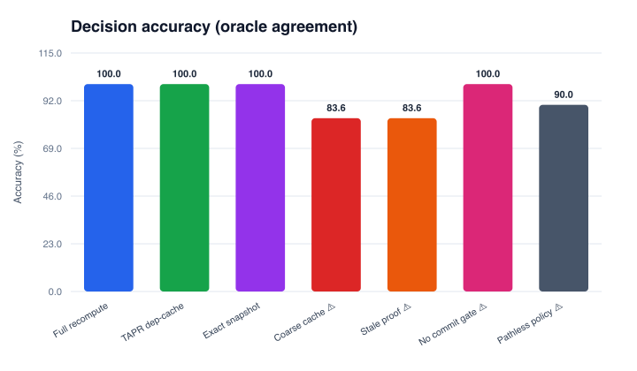
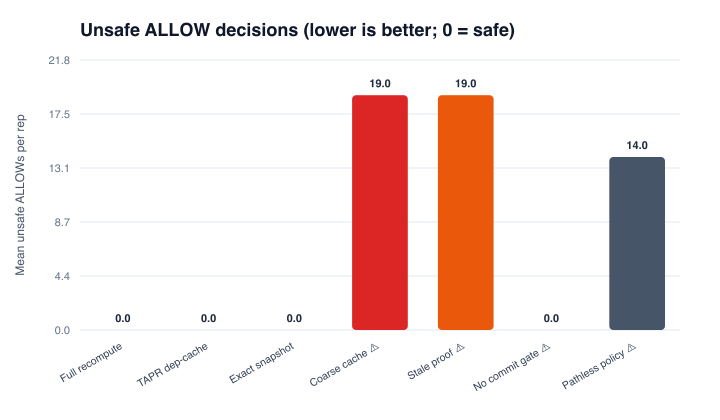
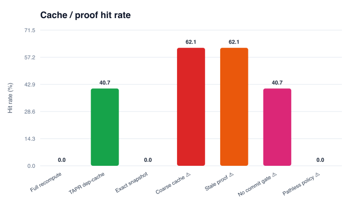
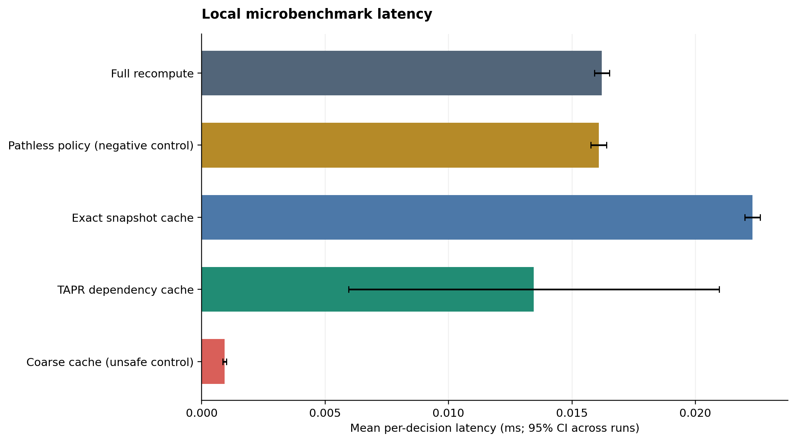
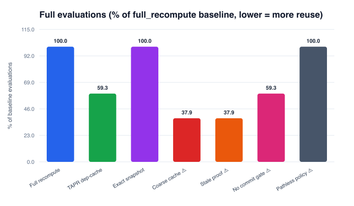
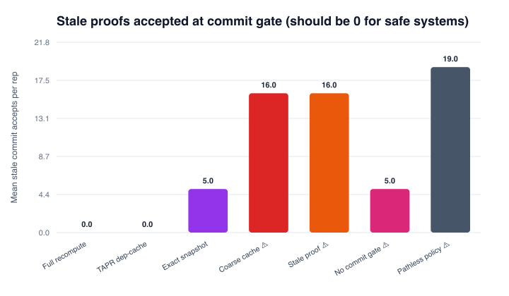

# Agent Runtime Research Lab v2 – Benchmark Report

> **Scope**: synthetic, deterministic, offline benchmark.  Results characterise this implementation on this workload only.  They do not constitute evidence of real-world agent safety, novelty relative to prior work, or superiority over production policy engines.

## Why stateful scenarios?

Current AI agent benchmarks almost exclusively measure *language quality* (final answer text, tool-call accuracy).  This benchmark instead measures the **runtime governance layer**: the system that decides whether a typed proposed action is admissible given the current world state, execution path, evidence, and active policy.  Scenarios are stateful event sequences, not isolated prompts.  This makes it possible to measure the most dangerous failure mode: a runtime that serves a cached ALLOW decision after the authorization has been revoked.

## Systems

| System | Type | Description |
|--------|------|-------------|
| Full recompute | Safe baseline | Always evaluates from scratch. |
| TAPR dep-cache | Safe (hypothesis) | Cache keyed by explicit dependency set; evicts on any dependency change; validates at commit gate. |
| Exact snapshot | Safe comparison | Cache keyed by full world-state hash. Sound but low hit rate when irrelevant metadata changes. |
| Coarse cache | **Unsafe** control | Cache keyed by action+target only. Ignores authorization and evidence. |
| Stale proof accept | **Unsafe** control | Cache without dependency tracking; never evicts. |
| No commit gate | **Unsafe** control | TAPR cache but skips TOCTOU check at commit boundary. |
| Pathless policy | **Unsafe** control | Full recompute but path history is zeroed; cannot enforce path-dependent rules. |

## Results

| System | Accuracy | Unsafe ✗ | Cache hit | Full evals | Lat μs |
|--------|----------|----------|-----------|------------|--------|
| Full recompute | 100.0% | 0.0 | 0.0% | 921 | 14.20 |
| TAPR dep-cache ★ | 100.0% | 0.0 | 30.4% | 641 | 10.60 |
| Exact snapshot | 100.0% | 0.0 | 0.0% | 921 | 21.02 |
| Coarse cache ⚠ ⚠ | 84.7% | 100.0 | 52.0% | 442 | 7.77 |
| Stale proof ⚠ ⚠ | 84.7% | 100.0 | 52.0% | 442 | 7.48 |
| No commit gate ⚠ ⚠ | 100.0% | 0.0 | 30.4% | 641 | 10.43 |
| Pathless policy ⚠ ⚠ | 87.4% | 116.0 | 0.0% | 921 | 14.68 |

## Figures

## Interpretation limits

- The oracle and evaluator share a human-authored policy contract. They are separately implemented, but not independently authored.
- Scenarios are synthetic and typed. No LLM, no natural-language parsing.
- Proof-construction cost is a deterministic CPU-work proxy, not a real theorem prover.
- The commit gate is in-process and deterministic. Real concurrent TOCTOU requires atomic compare-and-swap.
- Latency is wall-clock Python `perf_counter_ns`. Do not compare across machines.
- No OPA/Rego or Cedar adapter is included in this run. See `EXTERNAL_BASELINES.md`.

## What to do next before a credible research claim

1. Author policy cases *independently* of the evaluator; freeze the contract before running comparisons.
2. Add real OPA/Rego and Cedar adapters with shared semantic-equivalence tests.
3. Implement a concurrent check/commit harness with deterministic race schedules.
4. Sweep path length, dependency fan-out, evidence cardinality, and policy complexity.
5. Measure the cost of dependency *discovery* vs the cost of recomputation.
6. Add the language layer: intent extraction accuracy, constraint retention, ambiguity escalation.
