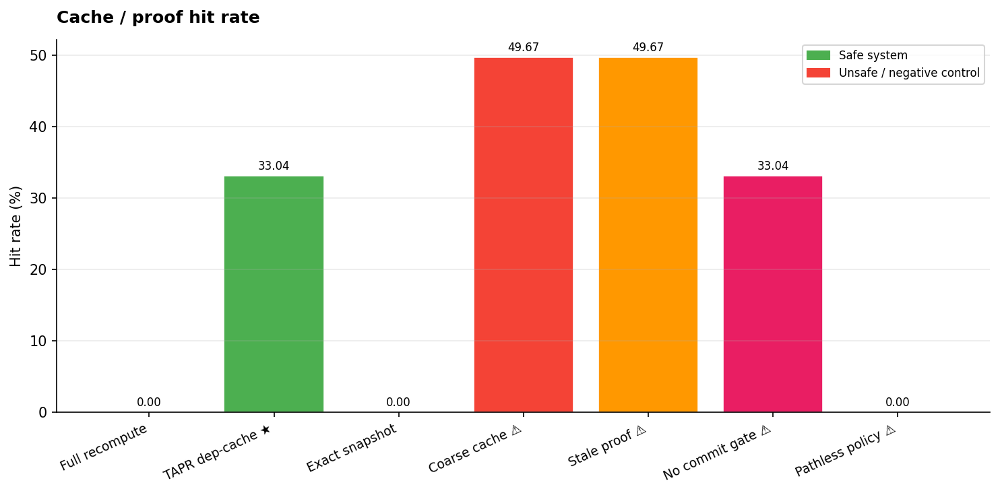
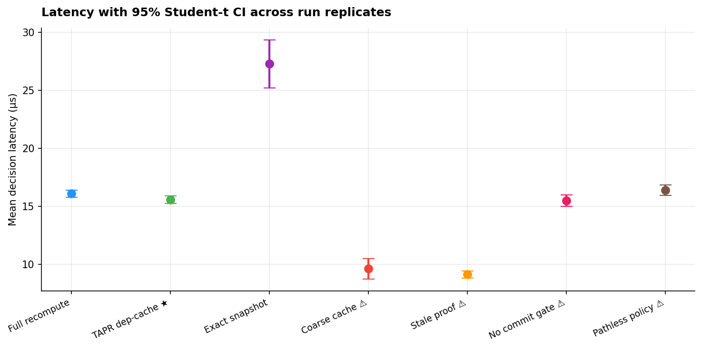
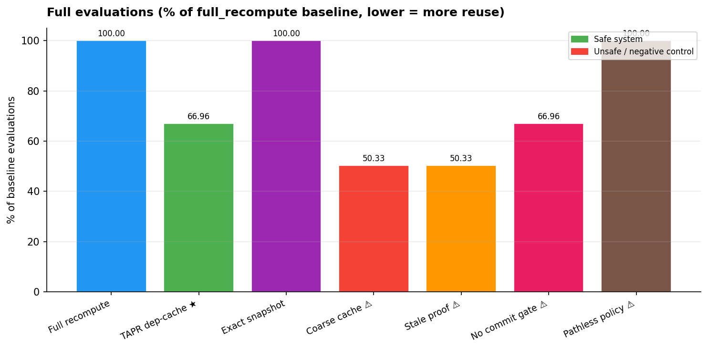

# Agent Runtime Research Lab v2 – Benchmark Report

> **Scope**: synthetic, deterministic, offline benchmark.  Results characterise this implementation on this workload only.  They do not constitute evidence of real-world agent safety, novelty relative to prior work, or superiority over production policy engines.

## Why stateful scenarios?

Current AI agent benchmarks almost exclusively measure *language quality* (final answer text, tool-call accuracy).  This benchmark instead measures the **runtime governance layer**: the system that decides whether a typed proposed action is admissible given the current world state, execution path, evidence, and active policy.  Scenarios are stateful event sequences, not isolated prompts.  This makes it possible to measure the most dangerous failure mode: a runtime that serves a cached ALLOW decision after the authorization has been revoked.

## Systems

| System | Type | Description |
|--------|------|-------------|
| Full recompute | Safe baseline | Always evaluates from scratch. |
| TAPR dep-cache | Safe (hypothesis) | Cache keyed by explicit dependency set; evicts on any dependency change; validates at commit gate. |
| Exact snapshot | Safe comparison | Cache keyed by full world-state hash. Sound but low hit rate when irrelevant metadata changes. |
| Coarse cache | **Unsafe** control | Cache keyed by action+target only. Ignores authorization and evidence. |
| Stale proof accept | **Unsafe** control | Cache without dependency tracking; never evicts. |
| No commit gate | **Unsafe** control | TAPR cache but skips TOCTOU check at commit boundary. |
| Pathless policy | **Unsafe** control | Full recompute but path history is zeroed; cannot enforce path-dependent rules. |

## Results

| System | Proposal accuracy | Unsafe ALLOW | Commit accuracy | Commit false denies | Stale accepts | Effects | Unsafe effects | Cache hit | Full evals | Work units | Proposal mean μs | Commit p95 μs |
|--------|-------------------:|-------------:|----------------:|--------------------:|---------------:|--------:|---------------:|----------:|-----------:|-----------:|-----------------:|--------------:|
| Full recompute | 100.0% | 0.0 | 100.0% | 0.0 | 0.0 | 83.0 | 0.0 | 0.0% | 920 | 19536.0 | 16.09 | 21.17 |
| TAPR dep-cache ★ | 100.0% | 0.0 | 100.0% | 0.0 | 0.0 | 83.0 | 0.0 | 33.0% | 616 | 11312.0 | 15.57 | 32.78 |
| Exact snapshot | 100.0% | 0.0 | 100.0% | 0.0 | 0.0 | 83.0 | 0.0 | 0.0% | 920 | 16240.0 | 27.28 | 28.18 |
| Coarse cache ⚠ ⚠ | 87.8% | 80.0 | 45.2% | 32.0 | 133.0 | 184.0 | 133.0 | 49.7% | 463 | 7408.0 | 9.62 | 0.21 |
| Stale proof ⚠ ⚠ | 87.8% | 80.0 | 45.2% | 32.0 | 133.0 | 184.0 | 133.0 | 49.7% | 463 | 7408.0 | 9.13 | 0.18 |
| No commit gate ⚠ ⚠ | 100.0% | 0.0 | 73.8% | 0.0 | 79.0 | 162.0 | 79.0 | 33.0% | 616 | 9856.0 | 15.48 | 0.71 |
| Pathless policy ⚠ ⚠ | 91.1% | 82.0 | 46.5% | 0.0 | 161.0 | 244.0 | 161.0 | 0.0% | 920 | 14720.0 | 16.39 | 0.18 |

Proposal accuracy and commit-boundary correctness are separate outcomes. An effect is counted only when the simulated effect counter is incremented after the runtime approves the commit; this is not an external adapter.

Uncertainty intervals use the two-sided 95% Student-t interval over independent benchmark repetitions. The sample unit is a repetition-level aggregate for a system (not an individual decision); intervals with few repetitions are correspondingly wide and should not be interpreted as population guarantees.

## Falsifiable question and hypotheses

Question: under the same typed scenario history and policy, can explicit dependency-aware proof reuse preserve proposal and commit decisions while reducing measured work relative to full recomputation?

- H1: TAPR proposal decisions agree with the state-only reference evaluator.
- H2: no stale authorization produces an approved commit/effect after a relevant state transition.
- H3: proof reuse reduces work only in workload regimes with reusable dependencies; it may lose at low reuse or when validation overhead dominates.

## Replication metadata

- Metric rows: 35; systems: 7.
- Run repetitions per system: 5 (independent sample unit).
- Use the adjacent `manifest.json` for the exact source revision, worktree status, versions, configuration, and raw artifact checksums.
- Reproduce using the positional configuration in `manifest.json`, e.g. `PYTHON=.venv/bin/python ./reproduce_research.sh <seed> 400 5 16 1`; outputs are written to a new timestamped directory.

## Figures

## Interpretation limits

- The oracle and evaluator share a human-authored policy contract. They are separately implemented, but not independently authored.
- Scenarios are synthetic and typed. No LLM, no natural-language parsing.
- Proof-construction cost is a deterministic CPU-work proxy, not a real theorem prover.
- The commit gate is in-process and deterministic. Real concurrent TOCTOU requires atomic compare-and-swap.
- Latency is wall-clock Python `perf_counter_ns`. Do not compare across machines.
- No OPA/Rego or Cedar adapter is included in this run. See `EXTERNAL_BASELINES.md`.

## What to do next before a credible research claim

1. Author policy cases *independently* of the evaluator; freeze the contract before running comparisons.
2. Add real OPA/Rego and Cedar adapters with shared semantic-equivalence tests.
3. Implement a concurrent check/commit harness with deterministic race schedules.
4. Sweep path length, dependency fan-out, evidence cardinality, and policy complexity.
5. Measure the cost of dependency *discovery* vs the cost of recomputation.
6. Add the language layer: intent extraction accuracy, constraint retention, ambiguity escalation.
